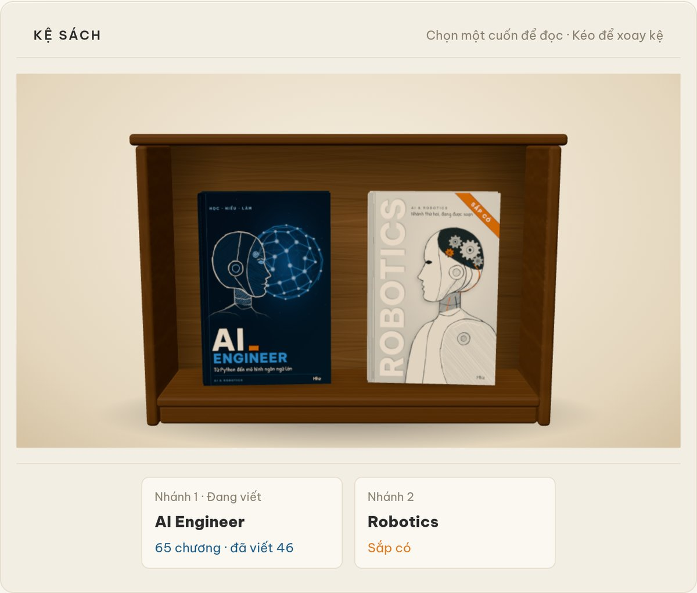
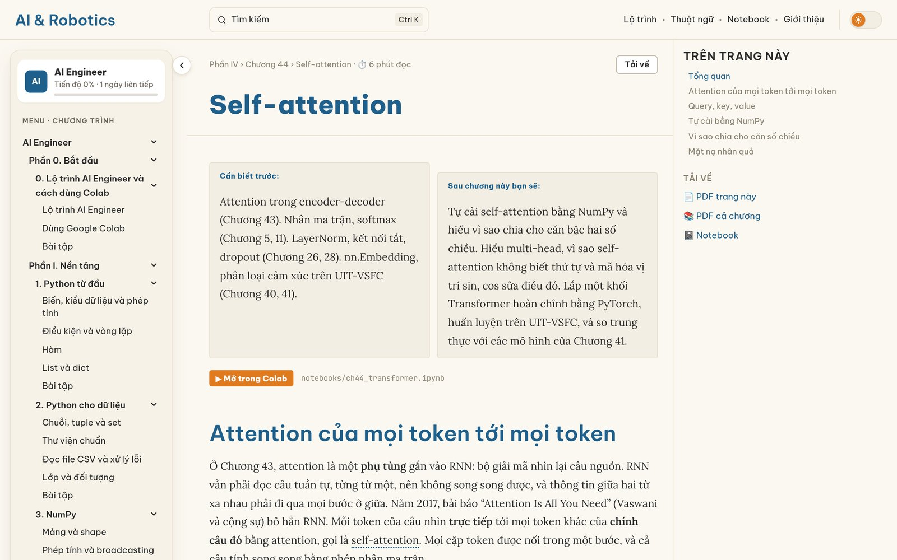

# AI & Robotics

Giáo trình tự học bằng tiếng Việt, hiện có nhánh *AI Engineer*: từ Python cơ bản đến Machine Learning, Deep Learning và mô hình ngôn ngữ lớn. Site dựng bằng Astro và Starlight, có giao diện sáng tối, công thức KaTeX và notebook thực hành mở thẳng trên Google Colab. Tác giả: Mhz.

**Đọc ngay:** https://ai-and-robotics-handbook.vercel.app

*A free, open-source Vietnamese textbook for aspiring AI engineers, from Python basics to machine learning, deep learning and large language models, with runnable Colab notebooks.*

<p align="center">
  
</p>

Mỗi chương đi qua năm bước: trực giác, toán, tính tay, code, đọc kết quả. Thuật ngữ mới được giải thích ngay chỗ gặp, cuối bài có câu hỏi tự kiểm tra, mỗi trang tải được PDF và mở được notebook trên Colab.

<p align="center">
  
</p>

## Chạy site trên máy

```bash
npm install
npm run dev        # xem tại http://localhost:4321
npm run build      # dựng bản tĩnh vào dist/
npm test           # kiểm thử đơn vị (vitest)
npm run e2e        # kiểm thử giao diện (playwright, cần: npx playwright install chromium)
```

## Notebook

Môi trường Python cho notebook nằm trong `.venv` (tạo bằng `uv venv .venv`, rồi `uv pip install -r requirements.txt`).

| Chương | Notebook | Mở |
|---|---|---|
| 10. Hồi quy tuyến tính | `notebooks/ch10_hoi_quy_tuyen_tinh.ipynb` | [](https://colab.research.google.com/github/mhieuz-dev/ai-engineer-handbook-vi/blob/main/notebooks/ch10_hoi_quy_tuyen_tinh.ipynb) |

## Làm lại ảnh

Bìa sách (SVG cho cảnh 3D, WebP cho kệ phẳng): `node scripts/bia/ve-bia.mjs`. Hình minh hoạ chương 10: `.venv/bin/python scripts/hinh/ch10_hoi_quy.py`.

## Thư viện bên thứ ba

Site dùng các thư viện và phông chữ mã nguồn mở sau, mỗi cái theo giấy phép riêng của nó.

| Thành phần | Giấy phép | Ghi chú |
|---|---|---|
| three.js | MIT, Copyright © 2010-2026 three.js authors | Dựng kệ sách 3D trên máy tính. Toàn văn giấy phép: `node_modules/three/LICENSE`; dòng bản quyền cũng được giữ lại trong chunk `canh-3d` của bản build. |
| KaTeX | MIT | Dựng công thức toán. |
| Be Vietnam Pro, Lora, JetBrains Mono, Patrick Hand | SIL Open Font License 1.1 (OFL) | Phông chữ, cài qua gói `@fontsource`. |

## Giấy phép

MIT, xem file `LICENSE`.
